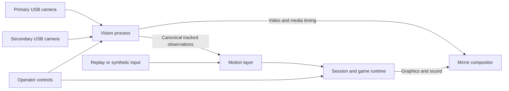

# Architecture

## Decision status

The accepted boundary is a local modular platform with model-independent game input. Python vision and a TypeScript/PixiJS mirror application are the provisional stack. Local WebRTC video delivery, the pose model, acceleration providers, and final desktop packaging remain proposals until the diagnostic experiment produces evidence. See [the decision index](decisions/README.md).

## Data flow

The video and observation paths split from a single camera acquisition owner. Their source timing must remain correlated through delivery and composition.

## Component ownership

| Component | Owns | Does not own |
| --- | --- | --- |
| `services/vision` | Capture, preprocessing, inference, camera-local tracking, multi-view association, observation export, calibration and media output | Game hits, scores or player-slot assignment |
| `packages/motion` | Canonical joint access, confidence handling, coordinate mapping, filtering, velocity and valid motion segments | Camera drivers or a particular pose model |
| `packages/session` | Player-slot assignments, session clock/lifecycle, pause and recovery state, capability checks | Detection or game-specific scoring |
| `games/<game>` | Game state, targets, collision rules, scoring, tuning and game-specific presentation | Camera access, model indices or player reidentification |
| `apps/mirror` | Composition, application shell, game loading, video presentation, operator controls and audio output | Inference or duplicate camera acquisition |
| `packages/diagnostics` | Timing and health views fed by reported measurements | Authoritative game state or privileged camera ownership |
| `contracts` | Canonical message semantics, future schemas and compatibility fixtures | Runtime-specific transport implementation |

Games use public motion and session interfaces. Shared packages never import individual games. The application composes them. Inference-specific output is translated at the vision boundary, so switching models does not change every game.

## Runtime arrangement

Begin with one local vision service and one mirror application, not distributed microservices. Use bounded capture/inference workers only where measurement justifies them. Keep blocking inference out of the renderer and service control event loop. Bound CPU thread pools and avoid simultaneous benchmark workloads on the development machine.

The vision process exclusively opens both cameras. Each acquired frame is referenced by the video path and the inference path; preview and gameplay do not independently reopen the same device.

Capture, inference, simulation, and rendering have independent rates. Prefer recent observations over processing every captured frame. Use bounded queues with observable drop counters and no unbounded catch-up loop. Render smoothly between useful observations; interpolation for presentation must not invent scoring input.

The session runtime controls joining, practice, countdown, playing, pause, results and restart. Per-player tracking quality is independent of the global session state. An ambiguous player may be suspended while others continue where the game rules permit it. Camera or calibration failures can require a global pause.

## Provisional technologies

| Area | First candidate | Required evidence |
| --- | --- | --- |
| Vision | Python and OpenCV with replaceable inference adapters | Stable capture on actual Windows/macOS hardware |
| Pose inference | Benchmark a lightweight multi-person detector/pose pipeline, such as RTMPose, against a MediaPipe baseline | Accuracy, complete-pipeline timing, model portability and provenance |
| Renderer | TypeScript and PixiJS | Target frame timing with video and three players |
| Operator interface | Small UI outside the animation loop; React is a candidate | Clear setup/recovery flow without frame-by-frame component updates |
| Observations and control | Loopback WebSocket | Bounded outgoing work, message validation, reconnect and stale-data behavior |
| Mirror video | Local WebRTC as a candidate | Capture-to-screen latency, pose/video skew and resource use |
| Acceleration | Provider adapter; CPU correctness path and hardware-specific options | Supported model operators and end-to-end timing per profile |
| Packaging | Defer browser kiosk versus desktop shell | Camera permissions, offline assets, launch/recovery and update needs |

PixiJS is a 2D renderer; it does not supply our session or tracking semantics. Python WebRTC tooling provides an experiment route, not a latency guarantee. ONNX Runtime supports multiple providers, but an available provider does not establish compatibility or performance for a selected model.

Sources: [PixiJS](https://pixijs.com/8.x/guides/getting-started/intro), [aiortc](https://aiortc.readthedocs.io/en/latest/), [RTMPose](https://github.com/open-mmlab/mmpose/tree/main/projects/rtmpose), [MediaPipe Pose](https://developers.google.com/edge/mediapipe/solutions/vision/pose_landmarker), [ONNX Runtime providers](https://onnxruntime.ai/docs/execution-providers/).

## Video and transport gate

Do not send base64 full-resolution frames through the observation WebSocket. Video and metadata have different throughput and timing requirements.

The first experiment must establish a mapping between source observation time, media presentation time and the renderer clock. Compare poses with the frame actually being presented, not whichever metadata message arrived most recently. Define a bounded matching wait and report residual skew. Extra video buffering consumes the feedback latency budget.

The proposed video path may fail the latency or integrated-graphics budget because of copying, encoding, decoding, or browser buffering. If so, revise media delivery/capture/composition before adding polished games; consider a native media bridge or a different capture/composition arrangement. Record the measured choice in [ADR 0002](decisions/0002-provisional-runtime-and-media.md). No fallback implementation is required in parallel before evidence exists.

Control commands require acknowledgements and explicit failure states. Observation snapshots are replaceable: skip superseded state rather than letting a slow client build a reliable-transport backlog. Bind local endpoints to loopback, validate control origins and message size, and avoid exposing camera control to the network by default.

## Capability and failure model

A performance profile declares maximum players, supported joint/collision capabilities, capture modes and active inference provider. The application checks a game's requirements before starting. Admission limits and quality changes must be visible; do not silently change scoring behavior to sustain load.

Disconnects, clock resets, calibration changes and tracker restarts create explicit stream epochs. Invalidate incompatible history, break motion trails, and reacquire players. A pose model must not quietly supply room-coordinate precision it has not established.

## Replay

Support synthetic and pose-replay adapters at the canonical observation boundary. Also capture game-ready input at the simulation boundary for reference scoring replays. [Coordinates and timing](coordinates-and-timing.md#replay-boundaries) defines the two levels. Raw video replay is an optional local diagnostic path and is not required for routine game development.
